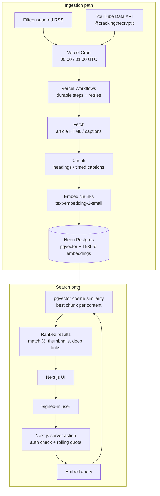

# RAG Video Suggester

A production RAG semantic-search app over cryptic-crossword content: Fifteensquared blog articles and Cracking the Cryptic YouTube videos. Ingestion turns both sources into embedded, section-aware chunks in Postgres/pgvector; search embeds the user's query, ranks the closest chunks, and returns match percentages, thumbnails, and deep links into the source content — timestamped YouTube links for videos and direct source-page links for articles.

## Features

- **Semantic search across articles and video captions.** Returns the best-matching chunk per piece of content, filtered to at least a 50% match and capped at 20 results.
- **Rich result cards.** Each result includes a match percentage, thumbnail, source type, and publish date. Video results deep-link to the matching timestamp.
- **GitHub OAuth sign-in.** Search is available only to signed-in users; sessions and OAuth tokens are handled by BetterAuth.
- **Bearer-secured cron ingestion.** `/api/ingest/fifteensquared` and `/api/ingest/youtube` require `Authorization: Bearer $CRON_SECRET` and return a workflow run ID immediately.
- **Durable Vercel Workflows.** Ingestion runs as retryable workflow steps. Items are processed in batches with per-item fault isolation, so one bad article or video does not abort the run.
- **Per-user rate limiting.** A rolling quota is enforced from recorded search history using `RATE_LIMIT_MAX_REQUESTS` and `RATE_LIMIT_WINDOW_HOURS`. The quota check and insert are serialized per user in one database transaction.
- **Video-aware fault handling.** Shorts, live/upcoming streams, unavailable videos, and captionless uploads are handled deliberately. Terminal skips are ledgered; fresh uploads get a 48-hour grace period to allow auto-captions to appear.

## Tech stack

| Area | Technology |
| --- | --- |
| App | Next.js 16 (App Router, Server Actions), React 19, TypeScript |
| Styling | Tailwind CSS 4 |
| Database | Neon Postgres, Drizzle ORM, Drizzle Kit |
| Vector search | `pgvector`, cosine distance, 1536-dimensional embeddings |
| Auth | BetterAuth with GitHub OAuth and Drizzle adapter |
| Embeddings | Vercel AI SDK + `@ai-sdk/openai`, `text-embedding-3-small` |
| Ingestion | Vercel Workflows, `rss-parser`, Cheerio, YouTube Data API v3, `youtube-transcript` |
| Validation | Zod |
| Testing | Vitest |

## Architecture



### Ingestion

1. Vercel Cron calls the ingestion routes daily. The routes verify the bearer token and start a workflow with `workflow/api`.
2. **Fifteensquared:** the workflow reads `https://fifteensquared.net/feed/`, filters out articles whose URLs already exist in `content`, fetches each new article, extracts the post body and thumbnail, and chunks the body on headings and `Across` / `Down` section labels.
3. **YouTube:** the workflow resolves the `@crackingthecryptic` uploads playlist, scans up to 50 new videos across at most 10 pages, ignores live/upcoming entries, skips videos under 60 seconds, and fetches English captions (falling back to the default track). Captions are chunked into roughly 1,000-character passages using 60-second windows and 20-second silence gaps, preserving each chunk's start time.
4. Chunks are embedded in batches with `text-embedding-3-small`, then written to `content` and `chunk` in a single `db.batch` transaction per item. Duplicate URLs are treated as terminal `FatalError`s rather than retried forever.
5. `skipped_video` records terminal skip reasons (`no_captions`, `zero_chunks`, `too_short`, `unavailable`). A recent video without captions is not ledgered immediately, so later runs can ingest it once captions appear.

### Search

1. The client calls the `searchContentAction` server action. The action requires a BetterAuth session and validates the query (1–500 characters).
2. `beginSearch` records the query in `search_query` if it fits the user's rolling quota. A per-user advisory lock and the conditional insert run in one `db.batch` transaction, so concurrent requests cannot over-admit.
3. The query is embedded with the same OpenAI model used for chunks.
4. Postgres ranks chunks by cosine distance, keeps the best chunk per content item, discards matches below 50% similarity, and returns at most 20 results.
5. The UI renders match percentages, thumbnails, and source links. Video links include `?t=<seconds>`; article links open the source page.

### Data model

| Table | Purpose |
| --- | --- |
| `content` | One ingested article or video: title, description, source URL, thumbnail, publish date, type, raw body/transcript. |
| `chunk` | A plain-text slice with an optional video start time and a 1536-dimensional embedding. |
| `skipped_video` | Terminal skip ledger so discovery does not retry videos that can never be ingested. |
| `search_query` | Per-user search history used for rate limiting, including returned content IDs. |
| Auth tables | BetterAuth users, sessions, accounts, verification records, and auth rate limiting. |

## Project structure

```text
src/
├── app/
│   ├── actions.ts                 # search server action: auth, quota, search
│   ├── page.tsx                   # server-rendered shell + session
│   ├── search.tsx                 # search form, result cards, error UI
│   ├── auth-controls.tsx          # sign-in / sign-out controls
│   └── api/
│       ├── auth/[...all]/route.ts # BetterAuth handler
│       └── ingest/
│           ├── fifteensquared/route.ts
│           └── youtube/route.ts
├── data/
│   ├── serverEnv.ts               # validated server environment
│   └── clientEnv.ts
├── db/
│   ├── db.ts                      # Drizzle + neon-http client
│   ├── schema.ts                  # schema barrel
│   ├── relations.ts
│   ├── schemas/                   # auth, content, chunks, skippedVideo, searchQuery
│   └── migrations/                # checked-in SQL migrations + snapshots
├── lib/
│   ├── auth/                      # BetterAuth server config + client
│   ├── chunking/                  # article and caption chunkers
│   ├── embedding/                 # AI SDK embedding helpers
│   ├── fifteensquared/            # article extraction
│   ├── search/                    # search, similarity, rate limits, history
│   └── youtube/                   # discovery, classification, transcripts
└── workflows/
    ├── ingestBlogArticles.ts
    ├── ingestVideos.ts
    └── utils/                     # batchExec, verifyAndRunCron
```

## Environment variables

Copy `.env.example` to `.env` and fill in the values below. All are server-side variables.

| Variable | Purpose | Notes |
| --- | --- | --- |
| `DATABASE_URL` | Postgres connection string | Neon connection string; migrations enable `pgvector`. |
| `BETTER_AUTH_SECRET` | BetterAuth signing/encryption secret | At least 32 characters. Generate with `openssl rand -base64 32`. |
| `BETTER_AUTH_URL` | Public origin of the app | e.g. `http://localhost:3000`. |
| `GITHUB_CLIENT_ID` | GitHub OAuth app client ID | Callback URL: `${BETTER_AUTH_URL}/api/auth/callback/github`. |
| `GITHUB_CLIENT_SECRET` | GitHub OAuth app client secret | |
| `CRON_SECRET` | Bearer token for ingestion routes | Vercel Cron sends it automatically when configured. |
| `OPENAI_API_KEY` | Embedding API key | Used for chunk and query embeddings. |
| `YOUTUBE_API_KEY` | YouTube Data API v3 key | Public-data access; no OAuth required. |
| `RATE_LIMIT_MAX_REQUESTS` | Maximum searches per user per window | Positive integer. |
| `RATE_LIMIT_WINDOW_HOURS` | Rolling rate-limit window | Positive number of hours, measured back from the current time. |

Optional: `BETTER_AUTH_TRUSTED_ORIGINS` accepts a comma-separated list of extra trusted origins.

## Getting started

### 1. Install dependencies

```bash
npm install --force
```

`--force` is required because the current dependency tree has a Vitest / `@types/node` peer conflict.

### 2. Configure the app

```bash
cp .env.example .env
```

Fill in the variables from the table above. For GitHub sign-in, create an OAuth app and set its callback URL to `http://localhost:3000/api/auth/callback/github` (or your deployed origin).

### 3. Set up the database

```bash
# Generate a migration after a schema change (no-op if nothing changed)
npx drizzle-kit generate

# Apply checked-in migrations
npm run db:migrate
```

Do **not** use `npm run db:push`. Migrations in `src/db/migrations` are the source of truth, and the vector extension is created by a migration.

### 4. Run the app

```bash
npm run dev
```

Open `http://localhost:3000`, sign in with GitHub, and search.

### 5. Trigger ingestion manually

The cron endpoints are `GET` routes secured with the same bearer token used by Vercel Cron:

```bash
curl -i http://localhost:3000/api/ingest/fifteensquared \
  -H "Authorization: Bearer $CRON_SECRET"
```

```bash
curl -i http://localhost:3000/api/ingest/youtube \
  -H "Authorization: Bearer $CRON_SECRET"
```

A successful request returns `202` with `{ "message": "Cron started", "runId": "..." }`; ingestion continues in the background. The schedules in `vercel.json` run Fifteensquared at 00:00 UTC and YouTube at 01:00 UTC.

## Testing

Run the full unit suite with:

```bash
npx vitest run
```

The suite covers article and caption chunking, article extraction, transcript normalization, video classification, result URL/timestamp building, search similarity, rate-limit helpers, and the search server action with mocked I/O.
